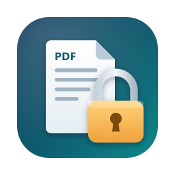

<p align="center"></p>

<h1 align="center">Chojema PDFLock</h1>

<p align="center">Protect PDF files with an open password and a permissions password · Windows / macOS</p>

<p align="center"><a href="README.md">한국어</a></p>

## Features

- **Open password**: only people who know it can open the file.
- **Permissions password**: restricts printing, editing, copying and more. Only this password lifts the restrictions.
- Set either password on its own, or both together.
- **AES-256** encryption (PDF 1.7 extension level 8 / PDF 2.0 standard).
- Drag and drop many files and protect them in one go.
- The original is left untouched; the result is saved as `name_locked.pdf`. Existing files are never overwritten — a number is added instead.
- Everything happens on your computer. No file ever leaves it.
- Korean and English UI, chosen automatically from your system language.

## Permission options

| Option | Description |
|---|---|
| Printing | High resolution / Low resolution only / Not allowed |
| Content editing | Change page content |
| Copying text and images | Select and copy content |
| Accessibility extraction | Let screen readers read the content |
| Comments and form editing | Add comments and change form fields |
| Form filling | Fill in existing form fields |
| Page assembly | Insert, delete and rotate pages |

If the permissions password is empty, the options are not applied and everything is allowed.

## Install

Download the latest version from the [Releases](../../releases) page.

- **Windows**: `Chojema.PDFLock_x.y.z_x64-setup.exe`
- **macOS**: `Chojema.PDFLock_x.y.z_universal.dmg` (Apple Silicon and Intel, macOS 11 or later)

The app is not code-signed, so you may see a warning the first time you run it.

- **Windows**: in the "Windows protected your PC" dialog, click **More info → Run anyway**.
- **macOS**: **Control-click (or right-click) the app → Open**. If it still won't open, go to **System Settings → Privacy & Security** and click **Open Anyway**.

## How to use

1. Drop PDF files onto the window, or click **Add files**.
2. Enter an open password, a permissions password, or both.
3. If you set a permissions password, choose which actions to allow.
4. Check where to save, then click **Protect**.

## Good to know

- **A forgotten password cannot be recovered.** Keep your passwords somewhere safe.
- Permission restrictions are honored by PDF viewers, but some programs ignore them. To truly protect content, use an **open password**.
- PDFs that are already password-protected are skipped.
- The open and permissions passwords must be different.

## Versioning

This project follows [Semantic Versioning](https://semver.org/) `MAJOR.MINOR.PATCH`.

- **MAJOR**: incompatible changes
- **MINOR**: new, backward-compatible features
- **PATCH**: bug fixes

Before 1.0.0, a MINOR release may also change behavior. See [CHANGELOG.en.md](CHANGELOG.en.md) for the history.

## Build from source

Requirements: [Node.js](https://nodejs.org/) 20+, [Rust](https://rustup.rs/), a C++ compiler (Windows: Visual Studio Build Tools, macOS: Xcode Command Line Tools)

```bash
npm install
npm run release-build                                      # current platform
npm run release-build -- --target universal-apple-darwin   # macOS Universal
```

For a macOS Universal build, first run `rustup target add aarch64-apple-darwin x86_64-apple-darwin`.

## License

[MIT](LICENSE) © 2026 Chulwoo Park

Uses [qpdf](https://github.com/qpdf/qpdf) (Apache-2.0) as the encryption engine.
