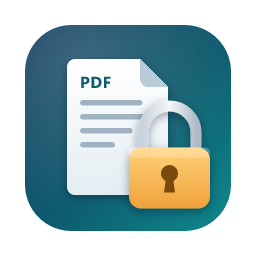

<h1 align="center">Chojema PDFLock</h1>

PDF 파일에 열기 암호와 권한 암호를 거는 데스크톱 앱 · Windows / macOS

<a href="README.en.md">English</a>

## 주요 기능

- **열기 암호**: 암호를 아는 사람만 파일을 열 수 있습니다.
- **권한 암호**: 인쇄, 편집, 복사 같은 작업을 제한합니다. 제한은 권한 암호로만 해제할 수 있습니다.
- 두 암호는 각각 따로 설정할 수 있고, 둘을 함께 걸 수도 있습니다.
- **AES-256** 암호화를 사용합니다(PDF 1.7 확장 레벨 8 / PDF 2.0 표준).
- PDF 파일 하나를 끌어다 놓거나 선택하면 첫 페이지 전체를 미리 보여 줍니다.
- **저장**(원본을 암호 걸린 파일로 교체) 또는 **다른 이름으로 저장**(기본 이름 `파일명_lock.pdf`, 수정 가능)을 고를 수 있습니다.
- 원본이나 기존 파일을 덮어쓰기 전에는 항상 확인을 받습니다.
- 모든 처리는 내 컴퓨터 안에서만 이루어집니다. 파일을 외부로 보내지 않습니다.
- 한국어와 영어를 지원하며, OS 언어에 따라 자동으로 바뀝니다.

## 권한 옵션

| 옵션 | 설명 |
|---|---|
| 인쇄 | 고해상도 허용 / 저해상도만 허용 / 허용 안 함 |
| 내용 편집 | 페이지 내용 수정 |
| 텍스트·이미지 복사 | 내용 선택 및 복사 |
| 접근성 추출 | 화면 읽기 프로그램이 내용을 읽도록 허용 |
| 주석 및 양식 편집 | 주석 추가와 양식 필드 수정 |
| 양식 채우기 | 기존 양식 필드에 값 입력 |
| 페이지 조립 | 페이지 삽입, 삭제, 회전 |

권한 암호를 비워 두면 권한 옵션은 적용되지 않고 모든 작업이 허용됩니다.

## 설치

[Releases](../../releases) 페이지에서 최신 버전을 내려받으세요.

- **Windows**: `Chojema.PDFLock_x.y.z_x64-setup.exe`
- **macOS**: `Chojema.PDFLock_x.y.z_universal.dmg` (Apple Silicon과 Intel 모두 지원, macOS 11 이상)

앱이 코드 서명되어 있지 않아서 처음 실행할 때 경고가 나타날 수 있습니다.

- **Windows**: "Windows의 PC 보호" 창에서 **추가 정보 → 실행**을 누르세요.
- **macOS**: 앱을 **Control-클릭(또는 오른쪽 클릭) → 열기**로 실행하세요. 그래도 열리지 않으면 **시스템 설정 → 개인정보 보호 및 보안**에서 **그래도 열기**를 누르세요.

## 사용법

1. PDF 파일을 창에 끌어다 놓거나 **파일 선택**을 누릅니다.
2. 열기 암호, 권한 암호 중 하나 이상을 입력합니다.
3. 권한 암호를 입력했다면 허용할 작업을 고릅니다.
4. **저장** 영역에서 **저장** 또는 **다른 이름으로 저장**을 누릅니다.
   - **다른 이름으로 저장**을 누르면 아래에 이름 입력 창이 나타납니다. 이름을 고친 뒤 **저장**을 누르세요. **폴더 선택…**으로 다른 폴더에 저장할 수도 있습니다.

## 알아 두세요

- **암호를 잊으면 복구할 수 없습니다.** 암호는 안전한 곳에 따로 보관하세요.
- 권한 제한은 PDF 뷰어가 지켜 주는 약속입니다. 일부 프로그램은 이를 무시할 수 있으므로, 내용을 실제로 보호하려면 **열기 암호**를 사용하세요.
- 이미 암호가 걸린 PDF는 처리하지 않습니다.
- 열기 암호와 권한 암호는 서로 달라야 합니다.

## 라이선스

[MIT](LICENSE) © 2026 Chulwoo Park

암호화 엔진으로 [qpdf](https://github.com/qpdf/qpdf)(Apache-2.0)를, 미리보기에 [PDF.js](https://github.com/mozilla/pdf.js)(Apache-2.0)를 사용합니다.
